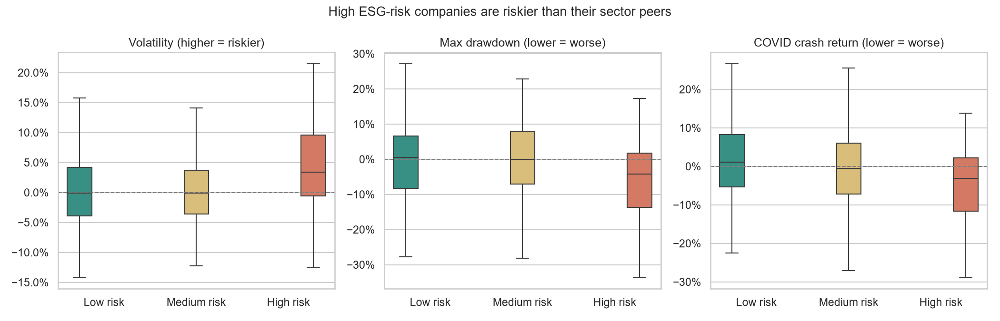

# Does ESG risk pay off?

**ESG risk ratings and stock performance of S&P 500 companies, 2019–2025**

Asset managers increasingly use ESG (Environmental, Social and Governance) ratings to select and weight portfolios. This project tests whether companies with lower ESG risk actually perform better in the stock market, in terms of **returns**, **risk** and **behaviour during crises**.

## Key findings

| | High vs low ESG risk (relative to sector) | Statistically significant? |
|---|---|---|
| Annual return | −0.6 pp | No (p = 0.92) |
| Volatility | +3.4 pp | Yes (p = 0.001) |
| Maximum drawdown | −4.8 pp | Yes (p = 0.006) |
| COVID crash (Feb–Mar 2020) | −4.2 pp | Yes (p = 0.003) |
| 2022 return | +9.1 pp | Yes (p = 0.006) |

1. **ESG risk is not a return signal.** Within each sector, ESG risk did not explain long-term returns.
2. **ESG risk is a modest risk signal.** High ESG-risk companies were more volatile, had deeper drawdowns and fell more in the COVID crash than their sector peers. The effect is significant but small (|ρ| ≈ 0.11–0.16).
3. **Sector comes first.** Without controlling for sector, raw data points the wrong way: the median "Severe" ESG-risk company returned +87% in 2022, driven by oil majors.
4. **Robustness:** all risk results hold, and the drawdown gap grows to −8.0 pp, when the energy sector is excluded.



## Data

| Source | Content |
|---|---|
| [S&P 500 ESG Risk Ratings](https://www.kaggle.com/datasets/pritish509/s-and-p-500-esg-risk-ratings) (Kaggle) | Sustainalytics ESG risk scores for 503 companies (2023). Lower score = lower unmanaged ESG risk. |
| Yahoo Finance (`yfinance`) | Daily adjusted closing prices, 2019–2025 (1,759 trading days) |

**Final sample: 411 companies.** 73 had no ESG score (spread across all sectors), 18 had no price data (mostly acquired, merged or renamed since 2023) and 1 had incomplete price history.

## Method

1. **Collection & cleaning** – load ESG ratings, fix data types, download prices in Python, retry failed tickers and remove incomplete series.
2. **Metrics** – for each company: annual return (CAGR), annualised volatility, maximum drawdown, COVID crash return and 2022 return.
3. **Sector adjustment** – each metric is expressed relative to the median of the company's sector, so an oil company is only compared with other oil companies.
4. **ESG groups** – Negligible + Low → Low risk (184), Medium → Medium risk (177), High + Severe → High risk (50).
5. **Statistical tests** – Mann-Whitney U (high vs low risk group) and Spearman correlation (ESG score vs each metric). Non-parametric tests are used because stock returns are not normally distributed.
6. **Robustness check** – all tests repeated excluding the energy sector.

## Limitations

- One 2023 rating snapshot applied to 2019–2025; ratings may have changed during the period.
- Survivorship bias: companies without full price history were removed.
- One rating provider (Sustainalytics); providers often disagree.
- No controls for size, value or market beta.
- Correlation, not causation.

## Repository structure

```
├── data/
│   ├── SP 500 ESG Risk Ratings.csv   # raw ESG ratings (Kaggle)
│   ├── esg_clean.csv                 # cleaned ESG data
│   ├── prices_raw.csv                # daily prices (yfinance)
│   ├── analysis_dataset.csv          # ESG + metrics
│   └── analysis_final.csv            # with ESG groups and sector-adjusted metrics
├── figures/                          # charts used in the presentation
├── notebooks/
│   └── esg_sp500_analysis.ipynb      # full analysis
├── presentation/                     # project presentation (PDF)
├── requirements.txt
└── README.md
```

## How to run

```bash
pip install -r requirements.txt
```

Open `notebooks/esg_sp500_analysis.ipynb` and run all cells. Prices are downloaded from Yahoo Finance, so results may vary slightly if tickers change.

**Tools:** Python · pandas · NumPy · yfinance · SciPy · matplotlib · seaborn

## Author

**Raúl Delgado Jerez** – Data Analytics, Ironhack · BSc Economics & Business Administration

[LinkedIn](https://www.linkedin.com/in/rauldelgadojerez/)
